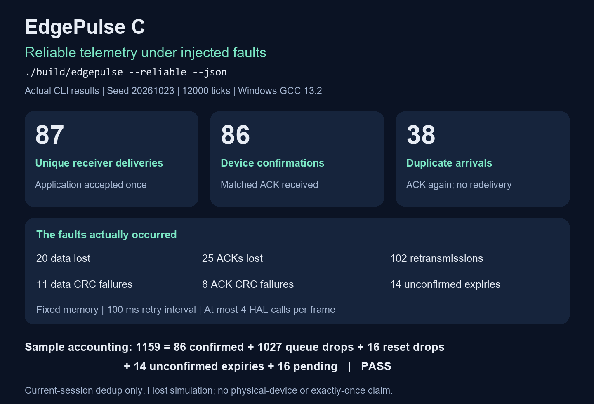

# EdgePulse C

A portable C device core with bounded ACK retries, receiver deduplication, deterministic fault simulation and persistent host configuration.

**Build and test an embedded acquisition pipeline without a board, existing firmware, or a virtual machine. Exercise framed communication, acknowledgement loss, bounded retries, duplicate suppression, configuration recovery and watchdog resets with reproducible inputs.**

English | [中文](README_ZH.md)

[Quick start](#quick-start) · [Design](#design) · [Validation](#validation)



The image lays out actual CLI output; it is not a terminal screenshot.

## Quick start

Requires a C11 compiler. Tests also use Python 3.9+ (standard library only). The application and its core are written in C and have no third-party runtime dependencies.

Windows with GCC on PATH:

```powershell
./scripts/build.ps1 -Mode test
./build/edgepulse.exe --demo
```

If GCC or Python is not on PATH, pass `-Compiler` and `-Python` with their executable paths. MSYS2 GCC is supported; no virtual machine is needed.

Linux:

```sh
make test
./build/edgepulse --demo
make sanitize
```

Run another reproducible scenario:

```powershell
./build/edgepulse.exe --seed 42 --ticks 12000 --json
```

Enable receiver acknowledgements and bounded retries:

```powershell
./build/edgepulse.exe --reliable --demo
./build/edgepulse.exe --reliable --seed 42 --ticks 12000 --json
```

`--reliable` is opt-in and works with `--store FILE`. Without it, the original demo and JSON fields retain their existing semantics. Reliable mode injects data/ACK loss, CRC corruption and duplicates into two separately parsed byte streams; ACKs are queued and dispatched after the device tick returns. It is a host simulation, with no real UART or network connection.

Save configuration, read it in another process, and run a demo with those values:

```powershell
./build/edgepulse.exe config set build/device.epcfg 25 -12500
./build/edgepulse.exe config show build/device.epcfg
./build/edgepulse.exe --store build/device.epcfg --demo --json
./build/edgepulse.exe config show build/device.epcfg
```

On Linux, use `./build/edgepulse` with the same arguments. `set` creates a missing file or updates a valid existing file; `show` and `--store` require an existing valid file. Parent directories must already exist. Paths containing spaces must be quoted; the Windows CLI and backend support Unicode paths. Local `*.epcfg` files are ignored by Git.

`config set FILE PERIOD_MS THRESHOLD_MC` accepts a period of 10..60000 ms and a threshold of -40000..125000 mC. `set` and `show` print JSON containing `period_ms`, `threshold_mc`, `generation` and `persistent:true`. `show` does not create or write a file. The demo holds the file lock until exit and submits the loaded values once through the configuration protocol, then sends a duplicate command: values stay the same, while the successful submission advances the stored generation once. Demo JSON includes the active values and `persistent` status.

`--ticks` accepts 10..1000000 one-millisecond scheduler steps; `--seed` accepts 1..4294967295. A single injected stall adds 5000 ms. Exit status is 0 on success, 2 for invalid arguments, and 1 for storage, locking, format or reconciliation errors. Storage errors produce no success JSON. `--help` lists options.

## Design

| Module | Implemented behavior |
| --- | --- |
| `src/protocol.c` | CRC16-CCITT-FALSE, little-endian encoding, an 82-byte stream buffer, fragmented/coalesced input and byte-wise recovery |
| `src/store.c` | Two 24-byte records, version and CRC validation, last-byte commit, RAM interruption tests, generation rollover and an optional commit callback |
| `src/file_store.c` | A 48-byte host configuration file, exclusive sessions, three synchronized commit stages and recovery from the remaining valid slot |
| `src/device.c` | Cooperative sampling, sensor/link HAL, 16-frame FIFO, overload accounting and optional stop-and-wait ACK/retry state |
| `src/receiver.c` | Explicit device/boot session, 16-frame duplicate window, serial-number ordering and application acceptance before ACK |
| `src/main.c` | Configuration commands, optional file-backed/reliable demos, deterministic faults, separate data/ACK parsers and reconciliation |

The protocol, store, device and receiver core have no dynamic allocation or OS dependencies. The host CLI and file backend may allocate memory for Windows Unicode conversion. HAL and receiver callbacks run serially, must return promptly, and must not re-enter their owner. No thread or ISR synchronization is provided. Each tick samples at most once and makes at most one send HAL call. Missed sampling periods are counted instead of replayed in a burst. Unsigned millisecond arithmetic supports wraparound when adjacent calls are less than 2^31 ms apart.

The threshold produces a telemetry alarm flag. There is no physical actuator driver. A simulated watchdog detects a scheduler gap of at least 5000 ms on the next tick, increments the boot identifier, accounts for discarded queued frames, clears command history and reloads configuration.

### Wire format

All multibyte fields use little endian. Maximum payload length is 64 bytes.

| Byte offset | Field |
| --- | --- |
| 0..1 | Sync `A5 5A` |
| 2..3 | Version `01`, message type |
| 4..5 | Device ID, uint16 |
| 6..9 | Boot ID, uint32 |
| 10..13 | Sequence / command ID, uint32 |
| 14..15 | Payload length, uint16 |
| 16.. | Payload, followed by uint16 CRC |

CRC covers version through payload; polynomial 0x1021, initial 0xFFFF, no reflection or final XOR. `123456789` produces 0x29B1. Type 1 telemetry is `timestamp:u32 + temperature_mC:i32 + alarm:u8`. Type 2 configuration is `period_ms:u32 + threshold_mC:i32` and must match the current device and boot ID. Type 3 is a zero-payload telemetry ACK: its device, boot and sequence fields echo the accepted telemetry. Configuration commands do not use this ACK.

The parser accepts arbitrary transport chunks. On receiver idle/session end, call `ep_parser_flush` to reject an incomplete candidate and recover any complete frames behind it. The parser does not own a clock or enforce an idle timeout itself. CRC detects corruption; it does not authenticate commands.

### Configuration and delivery semantics

- Sampling period: 10..60000 ms; threshold: -40000..125000 mC. Core defaults and new file initialization: 100 ms and 30000 mC. The default RAM demo applies 10 ms and 30000 mC; a `--store` demo uses the saved values.
- A successful configuration is stored before becoming active. The last eight successful command IDs are cached per boot. Same ID and same values return duplicate without writing; different values conflict. Eviction or reboot ends this duplicate protection.
- A full queue drops the new sample and counts it. In default mode, a failed send retains the oldest frame; a successful send dequeues it and means only that the simulated link accepted it. Reliable mode retains the head until a matching ACK or an explicit timeout/reset discard. Neither mode persists telemetry.
- Without `--store`, config slots survive simulated watchdog resets inside one process and are reset to blank RAM on the next process start. The optional file backend preserves configuration across process starts. Its host file protocol does not implement MCU flash erase, timing or wear behavior.
- Boot IDs and counters are uint32 and wrap. Boot IDs are not persisted across process starts. Applications requiring globally unique sessions must supply a durable boot/session identity.

### Reliable delivery

Call `ep_device_enable_reliable` before sampling, sending or a reset; prior configuration commands are allowed. Enabling it twice or after device activity fails without mutation. The defaults are `EP_ACK_TIMEOUT_MS=100` and `EP_MAX_RETRIES=3`: one initial HAL call and at most three retries for each queue head. Every HAL call consumes the budget, including a `false` return, and subsequent attempts wait at least 100 ms. At the next 100 ms deadline after the fourth call, an unacknowledged head is discarded as `delivery_timeouts`. That tick does not send the next head. Retries preserve the original frame bytes.

An ACK is accepted only for the current head, after at least one successful HAL submission, with type 3, length 0 and exact device/boot/sequence identity. A later failed retry does not invalidate an earlier successful submission. Duplicate, old or mismatched ACKs cannot dequeue another frame. The watchdog clears retry/ACK state and queued samples while retaining reliable mode. ACK input is dispatched outside the send callback, after `ep_device_tick` returns.

The receiver accepts type 1 telemetry with length 9, alarm 0 or 1, and the explicitly selected device/boot identity. `ep_receiver_begin_session` is called by trusted session control; an incoming frame cannot select a new session. It clears history and sequence high-water state while retaining cumulative metrics. The receiver caches 16 complete accepted frames. An identical cached frame is acknowledged again without invoking the delivery callback; changed payload under a cached sequence is a conflict and receives no ACK.

For a sequence outside the cache, unsigned distance from the high-water sequence must satisfy `0 < distance < 2^31`. Gaps and uint32 wrap are supported; older, evicted, equal or exactly half-range sequences are rejected as stale. The first valid sequence in a session is accepted. Only a successful application delivery callback advances history/high-water state and produces an ACK. A failed callback leaves the frame retryable and the ACK output untouched. Side effects performed before returning `false` may repeat; returning `true` means application acceptance, not durable storage.

The reliable JSON fields distinguish the boundaries:

| Field | Meaning |
| --- | --- |
| `tx_attempts` / `retransmissions` | All send HAL calls / calls after a head's first attempt, including failed calls |
| `sent` / `acknowledged` | Heads dequeued by a valid ACK; these are equal in reliable mode |
| `delivery_timeouts` | Heads discarded after the bounded ACK wait; delivery remains unconfirmed |
| `wire_transmitted` / `wire_received` | Online encoded telemetry submissions / valid decoded telemetry arrivals, including duplicates |
| `receiver_unique` / `receiver_duplicates` | Application-accepted new telemetry / cached duplicate arrivals |
| `invalid_acks` | Decoded ACKs that do not confirm the current eligible head |
| `data_lost`, `data_corrupted`, `ack_lost`, `ack_rejected` | Injected loss/corruption and ACK parser rejection counters |

The sender reconciles `sampled = sent + dropped + reset_dropped + delivery_timeouts + pending` and `attempts = sampled + sensor_errors`. Raw arrivals reconcile as `wire_received = receiver_unique + receiver_duplicates` in the valid demo. ACK loss can leave `receiver_unique > acknowledged`: a timeout means **unconfirmed delivery**, not proof of non-delivery. Deduplication is volatile and session-scoped; session reset or repeated boot identities can permit redelivery. There is no authentication, durable telemetry log, or end-to-end/cross-process exactly-once guarantee.

Stop-and-wait deliberately limits throughput: a missing ACK holds the queue head while new samples continue arriving, and a failed HAL call still consumes retry time. In the default reliable campaign, 1159 samples reconcile as 86 confirmed, 1027 queue-full drops, 16 reset discards, 14 unconfirmed timeouts and 16 pending. The receiver accepted 87 unique frames and suppressed 38 duplicate arrivals, with 102 retransmissions. The 87-versus-86 difference demonstrates the distinction between application acceptance and sender confirmation. Reliable and default modes inject different faults; these counts are not a controlled packet-loss improvement comparison.

### Persistent configuration

The file contains exactly two 24-byte version-1 records, each with a generation, configuration, CRC and final commit byte. Existing files must have the exact 48-byte size and at least one valid record. Unknown, truncated or doubly corrupt files are rejected without rewriting them; a single valid slot remains recoverable. Creating a file uses exclusive creation and writes a synchronized default record before the requested update. Interrupted initialization can leave an invalid file; later opens reject it without overwriting it.

Each open session holds an exclusive lock: `CreateFileW` with no sharing on Windows, or nonblocking `flock` on Linux. Concurrent EdgePulse sessions fail promptly; closing or terminating the owner releases the lock. `show` has read-only configuration semantics, but uses the same exclusive read/write handle and therefore still needs file access permission. Only local regular files are supported; directories and final-component symlinks/reparse points are rejected. The backend does not traverse parent directory components to check for links.

An update touches only the inactive slot, in this order:

1. Clear its commit byte and synchronize the file.
2. Write bytes 0..22, including the CRC, and synchronize the file.
3. Write the final commit byte and synchronize the file.

Synchronization uses `FlushFileBuffers` on Windows and `fsync` on Linux. Only a confirmed backend commit updates the RAM image, active device configuration and successful-command history. An I/O or synchronization error leaves the outcome unconfirmed: after a final synchronization failure, reopening may reveal the complete new configuration. The backend refuses further writes until closed and reopened. `store_writes` counts accepted write attempts, including failed attempts; it is not a durable-success counter. RAM-only partial-write injection remains available, while file-backed saves require a complete-record operation.

The process-termination tests check recovery at explicit write/synchronization boundaries. They do not establish physical power-loss durability, network-filesystem behavior, sector independence or durability of the directory entry when a file is first created.

## Validation

```sh
python scripts/check_mutations.py --compiler gcc
```

The normal test entry point runs five C test executables, 14 CLI tests and 14 file-backend process tests. Protocol tests reconcile 10000 frames and process 100000 hostile bytes; storage tests cover 50 RAM interruption positions plus the external commit boundary; device tests cover overflow, retries, sensor failure, watchdog reset, tick wrap, duplicate/conflicting commands, wire validation and commit failure. Sender and receiver suites add 13 groups each for ACK eligibility, attempt limits, failed-send backoff, reset isolation, duplicate suppression, sequence wrap/eviction, explicit sessions and callback failure. File tests include 27 real process terminations at commit boundaries and 28 injected write/synchronization failures, alongside locking, format and access checks.

On 2026-10-25, Windows GCC 13.2.0 passed the PowerShell suite and a fresh Make build: protocol 8/8, store 10/10, existing device tests, reliable sender 13/13, receiver 13/13, CLI 14/14, and 13 of 14 file tests with only the POSIX FIFO case skipped. Windows symlink rejection ran successfully. All eight mutation variants were detected in three reproducible runs each, for 24 detections; the added cases cover wrong ACK acceptance, missing retries and duplicate redelivery. Compilation failures and timeouts do not count as detected defects.

The default RAM demo, without `--store` or `--reliable`, was rechecked against the compatibility baseline: seed 20261023 produces 1159 successful samples, with 593 delivered, 550 rejected by the full queue, 16 discarded at reset, and 0 pending. There are 40 failed sensor reads; the telemetry checksum remains 3411655967. The previously verified 25 ms / -12500 mC default-mode file-backed baseline is also retained in the report: 463 samples, 246 delivered, 201 dropped, 16 reset discards and 0 pending. With both `--store` and `--reliable`, this revision measured 463 samples, 82 confirmed, 84 unique receiver deliveries and 36 duplicate arrivals; configuration values stayed unchanged while generation advanced from 2 to 3. Both reliable demos reported `accounting_ok:true`. See the [acceptance report](docs/验收报告.md) for the complete counters and limits.

The Make run used a fresh `build/reliable-make-check` directory under Windows MSYS2; it is not a Linux runtime test. Linux and ASan/UBSan were not run locally. Remote results are determined by the PR's GitHub Actions checks; the workflow definition alone is not execution evidence.

## Porting to a board

Replace sensor and send callbacks with ADC/I2C/SPI/UART implementations; call the device tick from a monotonic clock; feed UART/DMA chunks to the parser and invoke flush after a defined idle timeout. Attach a board flash backend at the store commit boundary and adapt the record format and commit protocol to its erase/program constraints; the host file backend is not a board driver. Validate interrupt races, flash constraints, real watchdog behavior, stack limits and electrical faults on hardware. This repository does not contain an MCU startup file, linker script, BSP, RTOS or hardware validation result.
